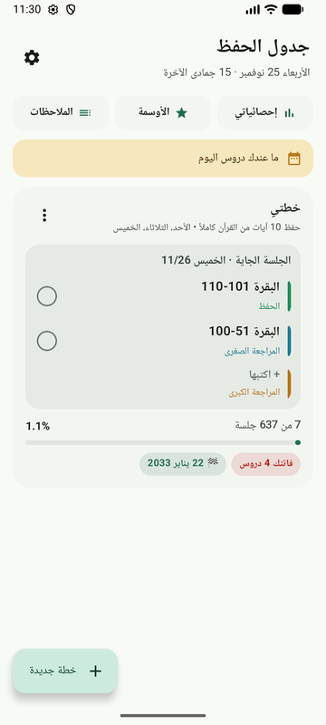
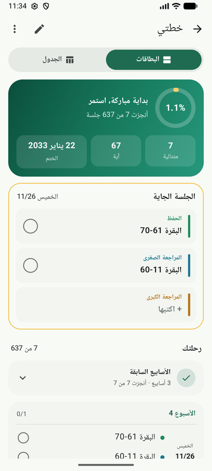
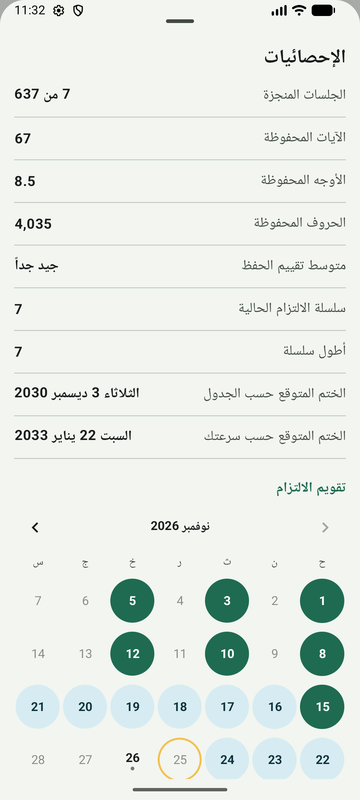
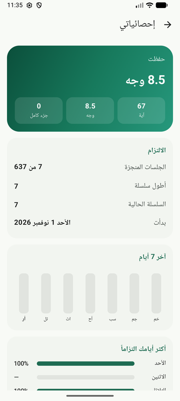
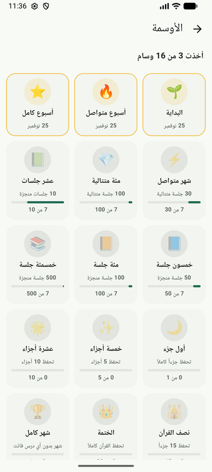
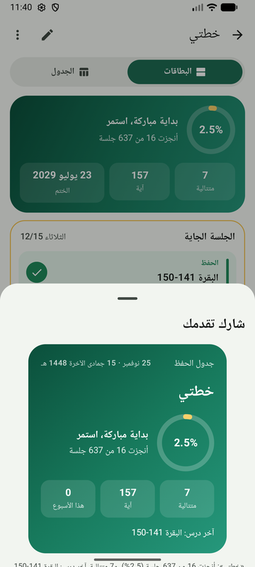
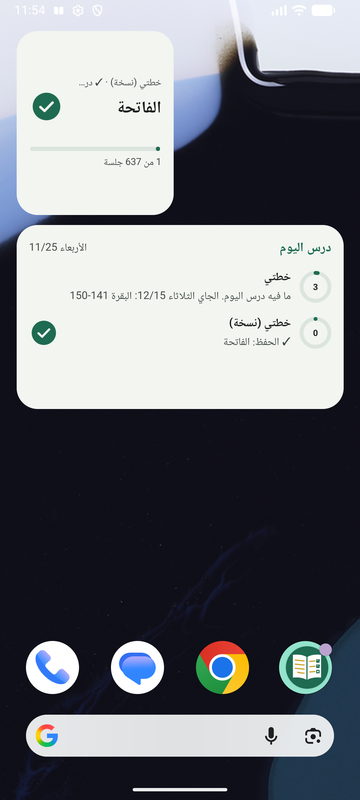
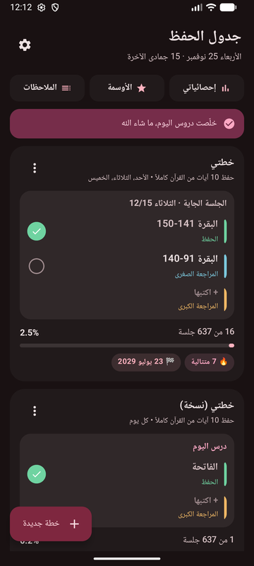

# Quran Hifz Planner · جدول الحفظ

An Android app that turns a Quran memorization plan into a day-by-day table: the new lesson, the minor and major reviews, ticks, grades and mistakes, with reminders and home-screen widgets. It works fully offline. The app's interface is in Arabic.

تطبيق أندرويد يحوّل خطة حفظ القرآن إلى جدول يوم بيوم: درس الحفظ، والمراجعة الصغرى والكبرى، والتأشير والتقدير وعدد الأخطاء، مع تذكير وودجت للشاشة الرئيسية. يشتغل كامل بدون إنترنت، وواجهته بالعربي.

**[⬇️ Download the latest APK · نزّل آخر إصدار](../../releases/latest)**

<p align="center">
  
  
  
  
</p>
<p align="center">
  
  
  
  
</p>

[English](#english) · [العربية](#العربية)

---

## English

### Features

**Plans and tables**
- Templates, or a plan built from your own paper table: new memorization, minor review (the last lessons), major review (generated or written by hand), and preparation.
- The whole Quran, or ranges by surah, juz, hizb or page. The amount per lesson in ayahs, pages, quarters, hizbs, juz, surahs or passages («مقاطع التفسير»).
- Study days by weekday, every N days, weeks or months, or spread to reach a finish date. Each review track can follow its own days.
- Gregorian and Hijri (Umm al-Qura) dates, with an adjustment of ±days.
- Cards and table views, ticks, grades, notes, and mistake and alert counters for every recitation.
- Missed lessons: move them forward automatically, catch up, or mark them done.
- Vacations: lessons wait until after them, and they never break a streak.
- Copy a plan, print the table or save it as PDF, and write sessions to the phone's calendar.

**Progress**
- Plan statistics with a monthly consistency calendar, streaks, the expected finish, and the lessons with the most mistakes.
- «إحصائياتي»: totals across all plans, the last 7 days, and your most consistent weekdays.
- 16 badges, celebrations for a finished juz or plan, and printable completion certificates.
- A progress picture to share, and a notes page with search.

**Outside the app**
- A daily reminder and a follow-up, with a «تم ✓» button that ticks today's session.
- An optional weekly report.
- Five widgets in three looks. Each one can tick today's session from the home screen.
- Launcher shortcuts: tick or open a plan from the app icon.

**Look**
- Six designs, colors from your wallpaper, or your own colors. Light and dark.
- Three fonts and four text sizes.
- An option to hide numbers (percentages, counts, streaks) for a calmer screen.

**Data**
- Everything stays on the phone. Backup to a file and restore.
- New versions install over old ones and keep every plan.

### Install

Download `HifzSchedule.apk` from [Releases](../../releases/latest) and open it on your phone. Android will ask you to allow installing from that source. It needs Android 8.0 or later.

### Build

Requirements: JDK 17 and the Android SDK (API 35). Android Studio works, or use the command line:

```bash
./gradlew testDebugUnitTest   # unit tests
./gradlew assembleRelease     # app/build/outputs/apk/release/app-release.apk
```

Release builds are signed with the local debug key, so a build from another machine cannot be installed over one from this repository's releases.

Built with Kotlin, Jetpack Compose (Material 3), Room and RemoteViews widgets.

### Project layout

| Path | What is there |
| --- | --- |
| `app/src/main/java/com/sallo/hifz/plan` | Scheduling and statistics, pure Kotlin with unit tests |
| `app/src/main/java/com/sallo/hifz/quran` | Quran metadata (surahs, ayahs, pages, juz, passages) and range text |
| `app/src/main/java/com/sallo/hifz/data` | Room database, migrations, backup, preferences |
| `app/src/main/java/com/sallo/hifz/ui` | Compose screens |
| `app/src/main/java/com/sallo/hifz/widget` | Home-screen widgets and launcher shortcuts |
| `app/src/main/java/com/sallo/hifz/reminder` | Reminders, the weekly report, «تم ✓» from outside the app |
| `tools/` | Generators for the Quran data and the widget layouts |

The widget layouts in `res/layout/widget_*.xml` are generated. Edit `tools/gen_widget_layouts.py`, then run:

```bash
python tools/gen_widget_layouts.py app/src/main/res
```

### Credits

- Quran metadata from the [Tanzil Project](https://tanzil.net), under [Creative Commons Attribution 3.0](https://creativecommons.org/licenses/by/3.0/).
- The passage division («مقاطع التفسير») follows the Tafsir Encyclopedia of [Dorar.net](https://dorar.net/tafseer). Only the ayah ranges are included.
- Fonts: [Almarai](https://fonts.google.com/specimen/Almarai) and [Noto Naskh Arabic](https://fonts.google.com/noto/specimen/Noto+Naskh+Arabic), under the [SIL Open Font License 1.1](https://openfontlicense.org) (texts in `tools/licenses`).

---

<div dir="rtl" align="right">

## العربية

### المميزات

**الخطط والجداول**
- قوالب جاهزة، أو خطة تبنيها من جدولك الورقي: الحفظ الجديد، والمراجعة الصغرى (آخر الدروس)، والمراجعة الكبرى (تلقائية أو تكتبها بنفسك)، والتحضير.
- القرآن كاملاً، أو نطاق بالسور أو الأجزاء أو الأحزاب أو الصفحات. ومقدار الدرس بالآيات أو الأوجه أو الأرباع أو الأحزاب أو الأجزاء أو السور أو «مقاطع التفسير».
- أيام الحفظ حسب أيام الأسبوع، أو كل كم يوم أو أسبوع أو شهر، أو توزيع حسب تاريخ الختم. وكل مسار مراجعة يقدر يمشي على أيامه.
- التاريخ الميلادي والهجري (أم القرى) مع تعديل الهجري.
- عرض بالبطاقات أو بالجدول، مع التأشير والتقدير والملاحظات، وعدّاد «أخطاء» و«تنبيهات» لكل تسميع.
- الدروس الفائتة: ترحيل تلقائي، أو تكمّلها من جديد، أو تعوّضها، أو تعلّمها كمنجزة.
- الإجازة: الدروس تتأجل لبعدها، وما تقطع «متتالية».
- نسخ الخطة، وطباعة الجدول أو حفظه PDF، ونقل الجلسات إلى تقويم الجوال.

**التقدم**
- إحصائيات الخطة مع تقويم الالتزام شهر شهر، والمتتالية، وموعد الختم المتوقع، وأكثر الدروس أخطاءً.
- «إحصائياتي»: مجموع كل خططك، وآخر 7 أيام، وأكثر أيامك التزاماً.
- 16 وسام، واحتفال لما تكمل جزء أو خطة، وشهادة إتمام تطبعها.
- صورة لتقدمك تشاركها، ودفتر ملاحظات فيه بحث.

**برا التطبيق**
- تذكير يومي وتذكير ثاني، فيه زر «تم ✓» يعلّم جلسة اليوم.
- تقرير أسبوعي اختياري.
- خمسة ودجت بثلاث هيئات، وتقدر تعلّم جلسة اليوم من الودجت على طول.
- اختصارات من أيقونة التطبيق: تعلّم أو تفتح الخطة.

**المظهر**
- ستة تصاميم، أو ألوان خلفية جوالك، أو ألوانك الخاصة. فاتح وداكن.
- ثلاثة خطوط وأربعة أحجام.
- «إخفاء الأرقام»: بدون نسب ولا عدّ ولا متتالية، لشاشة أهدأ.

**البيانات**
- كل شي محفوظ في جوالك، مع نسخة احتياطية في ملف واسترجاعها.
- الإصدار الجديد يتثبّت فوق القديم وخططك تبقى.

### التثبيت

نزّل `HifzSchedule.apk` من صفحة [الإصدارات](../../releases/latest) وافتحه في جوالك، ووافق على التثبيت من هذا المصدر لما يسألك أندرويد. يحتاج أندرويد 8.0 أو أحدث.

### البناء

تحتاج JDK 17 وAndroid SDK (الإصدار 35). تقدر تستخدم Android Studio أو سطر الأوامر:

</div>

```bash
./gradlew testDebugUnitTest   # الاختبارات
./gradlew assembleRelease     # app/build/outputs/apk/release/app-release.apk
```

<div dir="rtl" align="right">

نسخ الإصدار موقّعة بمفتاح التطوير المحلي، فالنسخة اللي تبنيها في جهاز ثاني ما تتثبّت فوق نسخة الإصدارات اللي هنا.

مبني بـ Kotlin وJetpack Compose (Material 3) وRoom.

### المصادر

- بيانات السور والآيات والصفحات والأجزاء من [مشروع تنزيل](https://tanzil.net)، برخصة [المشاع الإبداعي، النسبة 3.0](https://creativecommons.org/licenses/by/3.0/deed.ar).
- تقسيم «مقاطع التفسير» حسب موسوعة التفسير في [الدرر السنية](https://dorar.net/tafseer)، وفيه أرقام الآيات بس.
- الخطان [المراعي](https://fonts.google.com/specimen/Almarai) و[نوتو نسخ عربي](https://fonts.google.com/noto/specimen/Noto+Naskh+Arabic) برخصة [SIL Open Font License 1.1](https://openfontlicense.org)، ونصوصها في `tools/licenses`.

</div>
